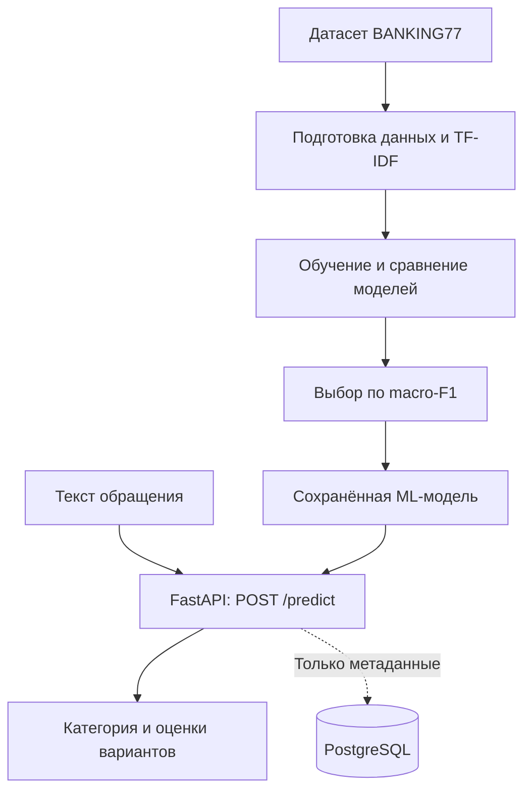

<div align="center">

# AI Support Intelligence

### ML-сервис классификации обращений в банковскую поддержку

**Python · Machine Learning · FastAPI · PostgreSQL · Docker**


</div>

## О проекте

**AI Support Intelligence** — учебный end-to-end проект на стыке **машинного обучения и Python Backend**. Сервис принимает текст обращения клиента банка, определяет предполагаемую категорию запроса и возвращает результат через REST API.

Например, обращение «My new bank card has not arrived yet» может быть отнесено к категории `card_arrival` (доставка карты).

Проект показывает полный путь ML-решения: **подготовка данных → обучение и сравнение моделей → оценка качества → сохранение модели → API для предсказаний → тесты и контейнеризация**.

> **Важно:** используемый датасет — **англоязычный**. Это учебный прототип, а не готовая банковская система. В проекте применяется классический ML, а не LLM или RAG.

## Возможности

- **Классификация обращений.** Обработка текста с помощью TF-IDF и модели машинного обучения.
- **Сравнение алгоритмов.** Обучение `Logistic Regression` и `Multinomial Naive Bayes`, выбор модели по `macro-F1` на валидации.
- **REST API на FastAPI.** Отправка текста, получение категории, оценок модели и нескольких наиболее вероятных вариантов.
- **Флаг проверки человеком.** Если оценка наиболее вероятной категории ниже заданного порога, возвращается `review_required: true`.
- **Опциональный PostgreSQL.** Сохранение категории, оценки модели, флага проверки и времени запроса — **без хранения исходного текста обращения**.
- **Инженерная часть.** Валидация запросов через Pydantic, тесты pytest, Docker Compose и CI на GitHub Actions.

## Технологии

| Направление | Инструменты |
|---|---|
| Язык | Python 3.11+ |
| Machine Learning | scikit-learn, pandas, TF-IDF, Logistic Regression, Multinomial Naive Bayes |
| Backend | FastAPI, Pydantic, Uvicorn |
| База данных | PostgreSQL, SQLAlchemy |
| Тестирование | pytest, httpx |
| Инфраструктура | Docker, Docker Compose, GitHub Actions |

## Архитектура



### Как обучается модель

1. Загружаются обучающая и тестовая выборки.
2. Обучающая выборка делится на части для обучения и валидации с сохранением пропорций классов.
3. Сравниваются два пайплайна: **TF-IDF + Logistic Regression** и **TF-IDF + Multinomial Naive Bayes**.
4. По `macro-F1` на валидации выбирается лучшая конфигурация.
5. Выбранная модель заново обучается на всей обучающей выборке и **один раз** оценивается на отдельной тестовой выборке.
6. Модель сохраняется в `artifacts/model.joblib`, а метрики — в `artifacts/metrics.json`.

Показатели качества: **accuracy** и **macro-F1**. Для воспроизводимости используется `random_state=42`.

## Данные

Для основного эксперимента используется [BANKING77](https://huggingface.co/datasets/PolyAI/banking77) — набор англоязычных обращений в банковскую поддержку:

- **77 категорий** обращений;
- **10 003** записи в обучающей выборке;
- **3 080** записей в тестовой выборке.

Скрипт скачивает CSV из зафиксированной версии [исходного репозитория PolyAI](https://github.com/PolyAI-LDN/task-specific-datasets) и проверяет **SHA-256** загруженных файлов.

Для быстрой проверки без интернета есть небольшой **синтетический demo-набор на 6 категориях** (`data/demo_train.csv` и `data/demo_test.csv`). Его результаты нельзя интерпретировать как качество модели на BANKING77.

## Быстрый запуск на Windows (PowerShell)

Все команды ниже выполняются **из корня проекта**. Нужен Python **3.11 или новее**.

**1. Создать виртуальное окружение и установить зависимости**

```powershell
py -3 -m venv .venv
.\.venv\Scripts\python.exe -m pip install -r requirements.txt
```

**2. Обучить демонстрационную модель (без интернета)**

```powershell
.\.venv\Scripts\python.exe -m ml.train --demo
```

**3. Запустить API**

```powershell
.\.venv\Scripts\python.exe -m uvicorn app.api:app --reload
```

Теперь доступны:

- **Swagger UI:** http://127.0.0.1:8000/docs
- **Проверка сервиса:** http://127.0.0.1:8000/health
- **OpenAPI:** http://127.0.0.1:8000/openapi.json

**4. Отправить запрос**

Через Swagger откройте `POST /predict` → **Try it out** и вставьте:

```json
{
  "text": "My card has not arrived yet",
  "top_k": 3
}
```

Или выполните в другом окне PowerShell:

```powershell
Invoke-RestMethod -Uri "http://127.0.0.1:8000/predict" -Method Post -ContentType "application/json" -Body '{"text":"My card has not arrived yet","top_k":3}'
```

API возвращает `category`, `score`, `review_required`, `candidates` и `model_version`. **Оценки и порядок категорий зависят от обученной модели.**

## Обучение на полном BANKING77

После проверки демоверсии можно обучить модель на настоящем датасете (нужен доступ в интернет):

```powershell
.\.venv\Scripts\python.exe -m ml.train
```

Скрипт скачает данные, проведёт обучение, сравнит модели и сформирует:

```text
artifacts/
├── model.joblib     # обученная модель
└── metrics.json     # метрики и параметры эксперимента
```

После этого **перезапустите API**. Артефакты модели и скачанные данные исключены из Git через `.gitignore`.

> **О результатах:** показатели качества для полного BANKING77 здесь не опубликованы, потому что обучение на нём нужно выполнить отдельно. Результаты демоверсии не являются подтверждением качества на 77 категориях.

## API

| Метод | Эндпоинт | Назначение |
|---|---|---|
| `GET` | `/health` | Проверить, загружена ли модель |
| `GET` | `/categories` | Получить список доступных категорий |
| `POST` | `/predict` | Классифицировать обращение |

Для `POST /predict`:

| Поле | Тип | Описание |
|---|---|---|
| `text` | `string` | Текст обращения (от 3 до 2000 символов) |
| `top_k` | `integer` | Число возвращаемых вариантов (от 1 до 5, по умолчанию 3) |

Если модель ещё не обучена, `/predict` возвращает HTTP **503**. Некорректные запросы отклоняются с HTTP **422**.

`score` — оценка классификатора, **не откалиброванная вероятность правильного ответа**. Порог `review_required` по умолчанию — `0.40`; это эвристика, а не гарантия безопасности.

## Запуск с Docker и PostgreSQL

Понадобится установленный Docker с поддержкой Compose.

**1. Обучить модель в контейнере:**

```powershell
docker compose --profile training run --build --rm train
```

**2. Поднять API и базу данных:**

```powershell
docker compose up --build -d api
```

**3. Открыть документацию API:** http://127.0.0.1:8000/docs

**4. Остановить сервисы:**

```powershell
docker compose down
```

PostgreSQL подключается автоматически в режиме Docker Compose. При локальном запуске без `DATABASE_URL` приложение работает **без базы данных**; настройки можно посмотреть в `.env.example`.

> Пароль в `compose.yaml` предназначен только для локальной разработки. Не следует размещать этот API в открытом доступе без авторизации, ограничений запросов и защиты данных.

## Тестирование и CI

```powershell
.\.venv\Scripts\python.exe -m pytest -q
```

Тесты проверяют обработку данных, обучение и работу API, включая валидацию и ситуацию с отсутствующей моделью. В `.github/workflows/ci.yml` настроен GitHub Actions: на `push` в `main` и pull request запускаются тесты и пробное обучение на offline demo-данных.

## Структура проекта

```text
ai-support-intelligence/
├── app/
│   ├── api.py              # эндпоинты FastAPI
│   ├── inference.py        # загрузка модели и предсказания
│   ├── schemas.py          # Pydantic-схемы
│   ├── storage.py          # PostgreSQL и сохранение метаданных
│   └── config.py           # конфигурация
├── ml/
│   ├── data.py             # загрузка и проверка данных
│   └── train.py            # обучение, выбор модели, метрики
├── data/
│   ├── demo_train.csv      # синтетические примеры для обучения
│   └── demo_test.csv       # синтетические примеры для проверки
├── scripts/
│   └── download_data.py    # отдельный скрипт загрузки BANKING77
├── tests/                  # автоматизированные тесты
├── artifacts/              # сюда сохраняются модель и метрики
├── .github/workflows/ci.yml
├── .env.example
├── Dockerfile
├── compose.yaml
├── requirements.txt
└── README.md
```

## Ограничения и дальнейшие улучшения

- Обучение выполнено для **английского языка**; для русского нужен подходящий датасет и отдельная оценка качества.
- Модель может ошибаться на неоднозначных обращениях и новых категориях.
- `review_required` использует простой порог, а не калиброванную вероятность.
- Для production потребуются аутентификация, защита персональных данных, мониторинг, миграции БД и дополнительные проверки качества.

Возможные следующие шаги: сравнение с эмбеддингами и трансформерами, анализ ошибок по категориям, калибровка оценок модели, развёртывание и мониторинг.

## Автор и лицензия

**GitHub:** [Natalie897](https://github.com/Natalie897)

Исходный код проекта распространяется по лицензии [MIT](LICENSE). Данные BANKING77 принадлежат PolyAI и распространяются отдельно по лицензии **CC BY 4.0**. Сведения о датасете и статье: Casanueva et al. (2020), [*Efficient Intent Detection with Dual Sentence Encoders*](https://arxiv.org/abs/2003.04807).

---

<div align="center">

*Pet-проект для развития навыков ML Engineering и Python Backend Development.*

</div>
