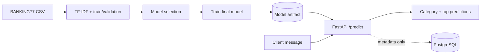

# AI Support Intelligence

**An end-to-end NLP/ML portfolio project:** classify banking support messages into intent categories with scikit-learn, serve predictions through FastAPI, and optionally record anonymized prediction metadata in PostgreSQL.

[](https://www.python.org/)
[](https://fastapi.tiangolo.com/)
[](https://pytest.org/)

## Features

- **Real supervised ML**: TF-IDF (uni-/bigrams) + comparison of Multinomial Naive Bayes and Logistic Regression.
- **Honest evaluation**: select model using a stratified validation set drawn only from the training partition; evaluate the selected retrained model once on the untouched official test set. Report accuracy and macro-F1.
- **Inference API**: `POST /predict`, `GET /categories`, `GET /health`; built-in Swagger documentation at `/docs`.
- **Human review flag**: low-confidence requests are flagged for manual review (heuristic threshold; model scores are not calibrated).
- **Optional PostgreSQL**: saves predicted category, score and timestamp — **not the customer's message text**.
- **Engineering**: pytest, input validation, graceful missing-model responses, Docker Compose, reproducible dataset download with SHA-256 checks.

### Architecture



## Dataset and scope

The project uses [BANKING77](https://huggingface.co/datasets/PolyAI/banking77), © PolyAI Limited, licensed **CC BY 4.0**. This is an **English-language** dataset with **77** intent labels, **10,003** training messages and **3,080** test messages. This project is not a Russian-language banking assistant and does not handle account operations or make consequential decisions.

Original files are fetched from a **pinned** PolyAI commit and verified against SHA-256 checksums; datasets are not committed to Git. If using the data, cite Casanueva et al. (2020), *Efficient Intent Detection with Dual Sentence Encoders* ([paper](https://arxiv.org/abs/2003.04807)).

## Quick start: local Python (Windows PowerShell or macOS/Linux)

Русская инструкция: [README_RU.md](README_RU.md).

Requirements: Python **3.11+**. Run all commands in the repository root.

```powershell
python -m venv .venv
# Activate the environment or call its Python executable explicitly:
# Windows PowerShell: .\.venv\Scripts\python.exe
# macOS/Linux: .venv/bin/python
# Commands below assume the venv is activated.
python -m pip install -r requirements.txt
python -m ml.train
python -m uvicorn app.api:app --reload
```

Windows PowerShell: run `.\.venv\Scripts\python.exe -m pip install -r requirements.txt`, then `.\.venv\Scripts\python.exe -m ml.train`, then `.\.venv\Scripts\python.exe -m uvicorn app.api:app --reload` (no activation required). `python -m ml.train` downloads the real BANKING77 dataset (internet required), compares baselines, trains the final model and writes `artifacts/model.joblib` and `artifacts/metrics.json`. These binary artifacts are ignored by Git.

Visit **http://127.0.0.1:8000/docs** or test the API:

```powershell
Invoke-RestMethod -Uri http://127.0.0.1:8000/predict -Method Post -ContentType 'application/json' -Body '{"text":"My card has not arrived yet","top_k":3}'
```

**Example response structure** (values/categories depend on trained model; no metric is preclaimed):

```json
{
  "category": "card_arrival",
  "score": 0.42,
  "review_required": false,
  "candidates": [{"category": "card_arrival", "score": 0.42}],
  "model_version": "20261026T120000Z"
}
```

> `candidates` returns up to `top_k` items. The example above is schematic, not a recorded inference. Model estimates are uncalibrated. In a real banking workflow, escalate low-confidence or unsupported-language inputs to a human.

### Offline demo (no network required)

```bash
python -m ml.train --demo
python -m uvicorn app.api:app --reload
pytest -q
```

The small `data/demo_*.csv` files are **illustrative synthetic data with only six categories** intended for checking the pipeline. **Do not report demo metrics as BANKING77 results.** Running the real train command afterward overwrites the demo model.

### Docker + PostgreSQL

```bash
# First build a real model; the training service downloads BANKING77
# and shares artifacts with the API via the local ./artifacts directory.
docker compose --profile training run --build --rm train
docker compose up --build -d api
# Swagger: http://127.0.0.1:8000/docs
# Shutdown: docker compose down
```

Postgres is not publicly exposed. Credentials in `compose.yaml` are **development-only** — change them before any public deployment. PostgreSQL persistence is optional when running Python locally; leave `DATABASE_URL` unset to disable it. If it is set, prediction metadata are stored in a table named `predictions` (table created on startup). No authentication/rate limiting is implemented; **do not expose this demo API directly to the internet**.

## Endpoints

| Method | Path | Purpose |
|---|---|---|
| `GET` | `/health` | Reports whether a model is available |
| `GET` | `/categories` | Lists supported classes |
| `POST` | `/predict` | Returns most likely intent and top-k candidates |

**Request:** `{ "text": "I lost my debit card", "top_k": 3 }`. English text, 3–2,000 characters; `top_k` from 1 to 5. If there is no trained model, `/predict` returns HTTP 503.

## Model development

Training: `python -m ml.train` → `ml/data.py` downloads verified CSVs → `ml/train.py` uses 85% of the official training data for fitting candidates and 15% for validation → picks by validation macro-F1 → retrains on the full official training split → evaluates **once** on official test. Metrics are written to `artifacts/metrics.json` (ignored by Git, since results must be reproducibly generated). Set random seed 42. Validation and test are separate to avoid test leakage.

**Limitations:** 77 fine-grained intents are easily confused; class probabilities are not calibrated, a global review threshold is a heuristic, predictions may be unreliable on unseen topics and on non-English inputs. For production: authentication, PII redaction, monitoring, calibration, migrations, and robustness tests are needed.

## Repository structure

```text
app/                 # FastAPI, request/response schemas, storage, inference
ml/                  # Dataset loader, verified download, training and evaluation
scripts/             # Optional standalone dataset downloader
specs/               # Reserved for future architecture notes
data/demo_*.csv      # Illustrative offline sample
artifacts/           # Generated model and evaluation metrics (gitignored)
tests/               # API, validation and training tests
Dockerfile
compose.yaml
requirements.txt
```

## Continuous integration

GitHub Actions runs unit tests and an offline demo-training smoke test on pushes to `main` and pull requests. The CI demo result is **not** a real BANKING77 benchmark.

## Tests

```bash
python -m pytest -q
```

## License

Project source code: [MIT](LICENSE). BANKING77 data is separately licensed CC BY 4.0 by PolyAI Limited, and is downloaded rather than bundled. This repository does not represent a bank or process real customer records.
